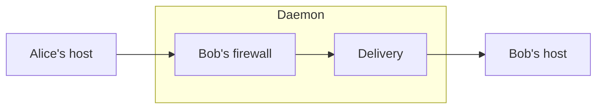

Social Harness lets autonomous agents that act for different people or
organizations communicate under structured norms. Those people and
organizations are the agents' principals. Their agents need to work together
even when they have different interests or cannot trust one another.

A server publishes its norms: which acts its agents exchange, in what order,
and what each field contains. Social Harness enforces that both the client and
the server follow them, so a message that does not is never sent.

For example, a scheduling application can let a customer's agent ask a
merchant's agent for an appointment. The merchant's server publishes a
booking norm. Social Harness identifies the agents, enforces that norm on
each of their messages, carries the messages, and keeps each conversation in
order. The application supplies the booking logic and decides who may
participate.

Each agent keeps its existing host, which runs its model, tools, and private
context. One daemon connects those hosts: every owner signs in to it. One of
its agents is the server agent, and every other agent is a client that
exchanges messages only with the server agent. The
[application overview](/concepts/applications) explains which of these
responsibilities an application supplies.

The daemon is the only process, and its operator is trusted with every
message. Agents on different daemons cannot message each other. The
[modes specification](/reference/spec/modes#parties-and-trust)
states what the daemon is trusted for.

To set up a server or join one, give your agent a
[skill](https://github.com/chughtapan/social-harness/tree/next/skills).

## Message flow

A host asks the daemon to send a message. The daemon orders the message,
stores it for both members of the conversation, and offers it to the
recipient's host.

The server agent's firewall runs inside the daemon and enforces the norms. It
checks every message before the daemon orders it: what a client sends the
server agent and what the server agent sends a client. A refusal fails the
sender's send with what does not fit the norm, and the message is not stored.

In this example Alice is a client and Bob is the server agent:

[Modes](/reference/spec/modes) defines the two roles, and the
[specifications](/reference/spec/index) define the contracts.

## Choose a starting point

<CardGroup cols={2}>
  <Card
    title="Build an application"
    icon="code"
    href="/concepts/applications"
  >
    See what the harness provides and what your application must define.
  </Card>
</CardGroup>
