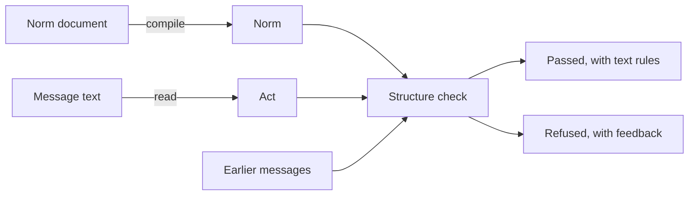

A norm says which acts the client and the server agent may send each other,
in what order, and what each field of an act contains. A server publishes
its norms: every member reads the documents with `read_norms`, and the daemon
enforces them on the client and the server agent alike. A message that does
not follow them is not sent.

This page defines the language in four parts: how a norm document and an act
are written, the norm a document denotes, when that norm is well formed, and
how the [firewall](./spec.md#one-check)'s structure check checks a
message against it.



## Example

A client books a meeting with the server agent:

```lisp
; A client books a meeting with the server.
(norm booking
  :description "The client asks for a meeting, the server offers slots, and the client picks one.")

(act request :by client :starts true :sets requested
  (field topic :type string :min-length 1 :max-length 200
    :description "The subject of the meeting."))

(act offer :by server :when requested
  :clears requested :sets offered
  (field slots :type list :min-items 1 :max-items 3
    :description "One meeting slot: a date, start and end times, and a timezone."))

(act pick :by client :when offered :ends true
  (field slot :type string)
  (relation member slot (previous offer slots)))

(act decline :by (client server) :ends true)
```

Under this norm a conversation goes as follows. Each act after the first
names the message it replies to as `replyToMsgId` in the send input.

| # | Sender | Message | Replies to | Result |
| --- | --- | --- | --- | --- |
| 1 | client | `Hello, can we meet?` | | Refused: the message is not one act. |
| 2 | server | `(request :norm booking :topic "Thesis outline")` | | Refused: `request` is not the server's to send. |
| 3 | client | `(request :norm booking :topic "Thesis outline")` | | Passed. It starts an instance, and `requested` is set. |
| 4 | server | `(offer :norm booking :slots ("Mon 10:00-10:30 UTC" "Tue 14:00-14:30 UTC"))` | 3 | Passed. `offered` is set in place of `requested`. |
| 5 | client | `(pick :norm booking :slot "Wed 09:00-09:30 UTC")` | 4 | Refused: the slot is not one of the offered slots. |
| 6 | client | `(pick :norm booking :slot "Tue 14:00-14:30 UTC")` | 3 | Refused: the reply chain from message 3 does not contain the offer. |
| 7 | client | `(pick :norm booking :slot "Tue 14:00-14:30 UTC")` | 4 | Passed. It ends the instance. |

Refused messages are not stored, so message 7 is the third message of the
conversation.

## Lexical structure

A norm document and a message's text are both sequences of these tokens:

| Token | Form |
| --- | --- |
| Whitespace | Any run of whitespace. It separates tokens and means nothing else. |
| Comment | `;` to the end of its line. A document may carry comments. A message that carries one is not an act. |
| `(` and `)` | Open and close a list. |
| String | A JSON string literal: text in double quotes with JSON escapes, on one line. It must decode to well-formed Unicode. |
| Symbol | Any other run of characters without whitespace, a parenthesis, `;` or `"`. |

A symbol has one of these forms, or none of them:

| Symbol | Form |
| --- | --- |
| Name | A lowercase letter followed by lowercase letters, digits or hyphens, 64 characters at most. Norms, performatives, fields and facts have names. |
| Keyword | `:` followed by a name, such as `:max-items`. |
| Number | A JSON number, such as `3`, `-2` or `1.5e3`. A number is whole when its value has no fractional part, so `10`, `1e1` and `2.0` are whole. |
| Truth value | `true` or `false`, which are also names. |

`Tue` and `0x2` are symbols of no form. Two texts are equal when they are the
same sequence of code points, and two numbers when they have the same value.
Nothing in a document or a message is evaluated.

## Norm documents

A document is one `norm` declaration followed by an `act` declaration for
each form. In this grammar, quoted words are symbols, `name`, `string` and
`number` are the tokens above, `[ x ]` is optional and `{ x }` repeats zero
or more times.

```ebnf
document   = norm , { form } ;

norm       = "(" , "norm" , name , [ ":description" , string ] , ")" ;

form       = "(" , "act" , name , { turn | field | relation } , ")" ;

turn       = ":by" , senders
           | ":starts" , truth
           | ":ends" , truth
           | ":when" , facts
           | ":clears" , facts
           | ":sets" , facts
           | ":max" , number
           | ":after" , name
           | ":delay" , name
           | ":unit" , "seconds" ;

senders    = role
           | "(" , role , { role } , ")"
           | "(" , "recipient" , "(" , "fact" , name , ")" , ")" ;
role       = "client" | "server" ;
facts      = name | "(" , { name } , ")" ;
truth      = "true" | "false" ;

field      = "(" , "field" , name , { field-attr } , ")" ;
field-attr = ":type" , type
           | ":optional" , truth
           | ":description" , string
           | bound , number ;
type       = "string" | "integer" | "list" ;
bound      = ":min-length" | ":max-length"
           | ":minimum" | ":maximum"
           | ":min-items" | ":max-items" ;

relation   = "(" , "relation" , operator , name , source , ")" ;
operator   = "equals" | "member" | "subset" ;
source     = "(" , "previous" , ( name | "(" , "fact" , name , ")" ) , name , ")" ;
```

The grammar leaves these rules to prose:

1. The name of a declaration follows its first word. After it, attributes
   come in any order, and in an `act` declaration they may stand between
   fields and relations.
2. A declaration takes each attribute at most once, and no attribute but
   those the grammar gives it. A misspelled attribute is therefore an error.
3. `:by` and `:type` are required. `:after`, `:delay` and `:unit` come
   together or not at all.
4. A field takes only the bounds of its type: `:min-length` and `:max-length`
   for a string, `:minimum` and `:maximum` for an integer, `:min-items` and
   `:max-items` for a list.
5. No field is named `norm`, because an act names its norm with `:norm`.

A role may be repeated in a sender list without effect, and a list of facts
may be empty, which is the same as leaving the attribute out. A text that
does not match the grammar and these rules is not a norm document, and does
not compile.

## Acts

A message's text is an act when the whole text is one list: a performative
followed by keyword and value pairs.

```ebnf
act       = "(" , name , { keyword , value } , ")" ;
value     = string | symbol | "(" , { string | symbol } , ")" ;
```

```lisp
(offer :norm booking :slots ("Mon 10:00-10:30 UTC" "Tue 14:00-14:30 UTC"))
```

1. The performative is a name, and each keyword is `:` and a name.
2. No keyword appears twice.
3. `:norm` is present, and its value is text that names the act's norm.
   Every other pair is a field of the act.
4. A string is text. A symbol in the form of a number is that number, and any
   other symbol is its own text, whatever its form: `Tue` and `"Tue"` are the
   same value. A list contains the text of each of its items, so a number
   inside a list is text.

A message whose text does not match the grammar and these rules is no act.
That includes a text with anything outside the one list, such as prose, a
second list, a comment or a Markdown fence.

The message a continuation replies to is not part of the act. The sender
supplies it as `replyToMsgId` in the
[send input](./spec.md#sending-a-message), and none is inferred.

## The norm a document denotes

The frontend translates a document into a norm, which is plain data. The
well-formedness rules and the structure check are defined on this data and
not on the document's text.

```text
Norm     = { name, description, forms: Form* }

Form     = { performative,
             by: Senders,
             fields: Field*,
             starts, ends: Boolean,
             when, clears, sets: Fact*,
             max?: Number,
             delay?: { fact, secondsField },
             relations: Relation* }

Senders  = roles(Role+)            ; a member that has one of these roles
         | recipient(Fact)         ; the recipient of the message that set the fact

Field    = { name, optional: Boolean, description?: String }
           and one of
             string  { minLength?, maxLength? }
             integer { minimum?, maximum? }
             list    { minItems?, maxItems? }

Relation = { operator: equals | member | subset,
             field,
             source: { act: EarlierAct, field } }

EarlierAct = performative(name)    ; the latest act of this performative
           | fact(Fact)            ; the act that set this fact

Act        = { performative, norm, fields: name -> FieldValue }
FieldValue = String | Number | String*
```

Each part of a document maps to one part of the norm:

| Document | Norm | When absent |
| --- | --- | --- |
| `(norm name …)` | `name` | Required. |
| `:description` of the norm | `description` | Empty. |
| `(act name …)` | A form whose `performative` is the name | |
| `:by` | `by` | Required. |
| `:starts`, `:ends` | `starts`, `ends` | False. |
| `:when`, `:clears`, `:sets` | `when`, `clears`, `sets` | No facts, as for an empty list. |
| `:max` | `max` | No limit. |
| `:after f :delay d :unit seconds` | `delay` with `fact` f and `secondsField` d | No delay. |
| `(field name …)` | A field | |
| `:optional` | `optional` | False: the field is required. |
| `:description` of a field | `description` | None. |
| `(relation op field (previous a f))` | A relation | |

## Well-formed norms

A document compiles when it is a norm document and the norm it denotes is
well formed. The daemon refuses to start with a document that does not
compile. The rules read the norm, so they apply to a norm however it was
written.

1. The name of the norm, of every performative, of every field and of every
   fact is a name, which the grammar already requires of a document.
2. No two forms declare the same performative, and no two fields of a form
   have the same name.
3. At least one form starts an instance.
4. A field's lower bound is not above its upper bound. The bounds of a string
   and of a list are whole numbers of zero or more. The bounds of an integer
   are any numbers.
5. `max` is a whole number of one or more.
6. Every fact in a `when`, a `clears`, a `recipient`, a delay or a
   relation's source is in the `sets` of some form.
7. A form that starts an instance names its senders by role, and has no fact
   in `when`, no delay and no relation.
8. For a delay, the form waits on the delay's fact in `when`, and every form
   that sets that fact declares the delay's `secondsField` as a required
   integer whose `minimum` is zero or more. A check that reaches the delay
   therefore always finds the act that set the fact and its number of
   seconds.
9. For a relation, the form declares the relation's field, and every form
   the source may name declares the source's field as a required field, so
   an earlier act always states it. A source that names a performative names
   one form, and one that names a fact names every form that sets the fact.
   The types fit the operator:

   | Operator | The form's field | The source's field |
   | --- | --- | --- |
   | `equals` | Any type | The same type |
   | `member` | String | List |
   | `subset` | List | List |

A norms directory has at least one document, and gives each norm a
different name.

## Checking a message

The structure check checks one message at a time. Its inputs are the
server's norms, the message with its sender's role and optional
`replyToMsgId`, the time of the check, and the conversation's stored
messages, each with the time of its own check. Times are Unix milliseconds.
It passes an act and names its [text rules](#text-rules), or refuses the
message with [feedback](#refusals). A server without norms runs no
structure check.

### State of a conversation

A check uses this state, which it rebuilds from the stored messages each time
and never saves:

| Part | Meaning |
| --- | --- |
| Stored messages | The id of every stored message. |
| Instance | The instance in progress, if any: its norm and the parts below. |
| Facts | The facts that are set, each with the act that set it. |
| Times sent | How many acts of each performative passed in the instance. |
| Acts | The acts that passed in the instance, in order. |
| Thread | The messages that belong to the instance, each with the message it replies to. |

The reply chain of a message id is that message, the message it replies to,
and so on, for as long as each is in the thread.

### Steps

A message is checked by these steps in order. The first step that fails
refuses the message at the stage shown. The form stage reads the message
alone, and the protocol stage reads the conversation.

| Step | The message is refused when | Stage |
| --- | --- | --- |
| 1 | Its text is not an [act](#acts). | Form |
| 2 | No instance is in progress and `:norm` is not the name of one of the server's norms. | Form |
| 3 | An instance is in progress and `:norm` is not the name of the instance's norm. | Protocol |
| 4 | The norm declares no form for the performative. | Form |
| 5 | A required field is missing, a stated field is not declared, or a value is not of its field's type or within its bounds. The feedback names every such field. | Form |
| 6 | The form does not start an instance and the message has no `replyToMsgId`. | Protocol |
| 7 | The message has a `replyToMsgId` that is not a stored message. | Protocol |
| 8 | No instance is in progress and the form does not start one, or an instance is in progress and the form starts one. | Protocol |
| 9 | An instance is in progress and the reply chain of `replyToMsgId` is empty: the act replies outside the instance. | Protocol |
| 10 | The senders are a `recipient` and its fact is not set, or the act that set it is not in the reply chain. | Protocol |
| 11 | The sender is not one `by` permits: it has none of the listed roles, or it is not the recipient of the message that set the fact. | Protocol |
| 12 | A fact of `when` is not set, or `max` acts of this performative already passed in the instance. | Protocol |
| 13 | The form has a delay and the time of the check is earlier than the time the act that set the delay's fact was checked, plus 1000 milliseconds for each second that act's `secondsField` says. The delay reads the fact whether or not the reply chain contains that act. | Protocol |
| 14 | A relation is not satisfied. Relations are tried in the order the form declares them. | Protocol |

From step 2 on, the message is checked under one norm: the instance's norm
when an instance is in progress, and the norm `:norm` names otherwise. An
act that starts an instance is checked by steps 1 to 8 and then step 11. It
may carry a `replyToMsgId` that names a stored message, which changes
nothing: the instance it starts begins with it.

A field's value fits its type as follows:

| Type | Value | Bounds |
| --- | --- | --- |
| `string` | Text. | `minLength` and `maxLength` count code points. |
| `integer` | A whole number. | `minimum` and `maximum` are inclusive. |
| `list` | A list of texts, none empty. | `minItems` and `maxItems` count items. |

A relation compares a stated field with a field of an earlier act. The
earlier act is found in the reply chain: for a source that names a
performative, the latest act of it that passed in the chain, and for a source
that names a fact, the act that set the fact, when the chain contains it.

| Operator | Satisfied when |
| --- | --- |
| `equals` | The field has exactly the earlier value: the same text, the same number, or the same items in the same order. |
| `member` | The field is equal to one of the earlier list's items. |
| `subset` | Every item of the field is equal to one of the earlier list's items. |

A relation fails when the earlier act is not in the chain, when the act does
not state the relation's field, or when its operator is not satisfied.
Setting a fact again replaces the act a source that names the fact finds, so
an old offer cannot authorize a selection after a new one.

Every refusal on this page has the reason `violation`.

### Effects of an act that passed

A stored act changes the state as follows:

1. If its form ends an instance, the instance is over: no facts, times sent,
   acts or thread remain.
2. Otherwise, if no instance is in progress, one starts under the act's norm.
3. The facts of `clears` are cleared. Then the facts of `sets` are set, each
   by this act.
4. The times sent of the act's performative rise by one, and the act joins
   the instance's acts.

A stored message joins the thread of the instance in progress when it is the
act that started it, or when it replies to a message in the thread.

### Replay

The state before a message is the result of replaying the conversation's
stored messages in order. Each stored message is checked again by the steps
above, as its sender, at the time of its original check. A message that
passes has its effects. A message that does not pass has none, though it may
still join the thread. That is a message stored before the norm documents
changed, or one stored while the server had no norms, which has no check
time.

A refused message is not stored, so it leaves no trace in the state and a
later message cannot reply to it. Nothing rewinds, restarts or cancels an
instance except an act of the norm.

## Text rules

The description of a string or list field is its text rule. When an act that
passed states a described field, the decision provider judges whether the
field contains only what its description says. A list's description says
what each of its items contains.

| Field | Rule text |
| --- | --- |
| String | `<field> must contain only what its description says: <description>` |
| List | `each item of <field> must contain only what its description says: <description>` |

A rule's id is `<norm>.<performative>.<field>`, such as
`booking.request.topic`. A document declares no other rule and no feedback:
the sender of an act that breaks a description reads the rule's text.

Write a description as what the field contains, such as "One meeting slot: a
date, start and end times, and a timezone." Anything else in the field breaks
the rule, so a description need not list unrelated instructions or prompt
injection. A field without a description is not judged. An integer is
limited by its bounds alone, and its description only explains it.

The provider judges the act using which member sent it, the
[history window](./spec.md#history-window) of earlier messages, the form's fields, the facts that are set and the
norm's description. The
[provider answers contract](./spec.md#provider-answers) owns uncertainty
and provider failures.

## Refusals

A refused message's send fails with feedback that says what does not fit:
the form, the sender or the turn. Feedback about an act that may not follow
names the performative of the message it replies to, when that message is an
act that passed.

| Refused at | Rule id | Feedback, for example |
| --- | --- | --- |
| Form stage | `<norm>-form` | `note is not a valid field of pick in booking.` |
| Protocol stage | `<norm>-protocol` | `pick is not valid after offer for booking.` |
| A text rule | `<norm>.<performative>.<field>` | The rule's text. |

In a structure check's rule id, the norm is the one the message was checked
under. For a message refused at step 1, that is the norm of the instance in
progress. A message refused at step 1 or 2 while no instance is in progress
was checked under no norm, and its rule is `norm-form`.

The feedback is all a refusal says of the norm. The server agent's failure
adds the check and the reason, and a client reads the feedback alone, as
[refused messages](./spec.md#refused-messages) states. A refusal does
not select a replacement act or reply reference, or instruct the agent to
restart an instance.

## Publishing norms

The daemon's `normsDirectory` setting names a directory. The daemon compiles
every `.lisp` file directly inside it before it serves, and refuses to start
when there is none or one does not compile. The norms they compile to are
the server's norms until the daemon stops: `read_norms` returns each norm's
name, description and document, and the firewall enforces every one. No rule file or built-in agreement is installed beside them, and a
message cannot install a norm.

Documents are compiled at startup. After a restart every conversation is
checked under the documents then in the directory, as [replay](#replay)
describes.

A norm adds no delivery acknowledgment, notification, timer, send lock or
host behavior. A delay only refuses an act sent too early: it schedules
nothing, and the host waits.
