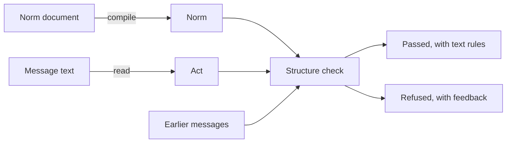

A norm is a published rule for one kind of exchange between a client and the
server agent, such as booking a meeting. It says which messages each side may
send, in what order, and what each part of a message may contain. Every
member can read a server's norms with `read_norms`. The daemon checks every
message against them, and a message that does not follow them is not sent.

The first two sections explain how norms work, starting from an example. The
sections after them are reference: the syntax, the rules a norm must follow,
and the exact steps of a check.

## Example

This norm lets a client book a meeting with the server agent:

```lisp
; A client books a meeting with the server.
(norm booking
  :description "The client asks for a meeting, the server offers slots, and the client picks one.")

(act request :by client :starts true :sets requested
  (field topic :type string :min-length 1 :max-length 200
    :description "The subject of the meeting."))

(act offer :by server :when requested
  :clears requested :sets offered
  (field slots :type list :min-items 1 :max-items 3 :format date-time)
  (field length :type string :format duration))

(act pick :by client :when offered :ends true
  (field slot :type string :format date-time)
  (relation member slot (previous offer slots)))

(act decline :by (client server) :ends true)
```

A conversation under this norm might go as follows. Each act after the first
gives the id of the message it replies to, as `replyToMsgId` in the send.

| # | Sender | Message | Replies to | Result |
| --- | --- | --- | --- | --- |
| 1 | client | `Hello, can we meet?` | | Refused: the message is not one act. |
| 2 | server | `(request :norm booking :topic "Thesis outline")` | | Refused: `request` is not the server's to send. |
| 3 | client | `(request :norm booking :topic "Thesis outline")` | | Passed. It starts an instance, and `requested` is set. |
| 4 | server | `(offer :norm booking :slots ("2026-11-23T10:00:00Z" "2026-11-24T14:00:00Z") :length "PT30M")` | 3 | Passed. `offered` is set in place of `requested`. |
| 5 | client | `(pick :norm booking :slot "2026-11-25T09:00:00Z")` | 4 | Refused: the slot is not one of the offered slots. |
| 6 | client | `(pick :norm booking :slot "2026-11-24T14:00:00Z")` | 3 | Refused: the reply chain from message 3 does not contain the offer. |
| 7 | client | `(pick :norm booking :slot "2026-11-24T14:00:00Z")` | 4 | Passed. It ends the instance. |

Refused messages are not stored, so message 7 is the third message of the
conversation.

## How a norm works

This section describes what a norm means. It does not depend on how a norm is
written; [Syntax](#syntax) covers that.

**Acts.** A message under a norm is an *act*. An act has a *performative*,
which is the kind of act it is, the name of its norm, and named *fields*. In
the example, the first accepted message is an act with the performative
`request`, the norm `booking`, and one field, `topic`.

**Forms.** A norm declares one *form* for each performative. A form lists the
fields an act of that kind carries, and gives its *turn rule*: the conditions
under which the act may be sent.

**Instances.** One run of a norm in a conversation is an *instance*. A form
says whether its act starts an instance or ends one. In the example,
`request` starts a booking, and `pick` or `decline` ends it. A conversation
has at most one instance in progress.

**Facts order the acts.** A *fact* is a named flag of an instance. A form
says which facts its act sets, which it clears, and which must already be set
before the act may be sent. In the example, `request` sets `requested`.
`offer` requires `requested`, clears it and sets `offered`. `pick` requires
`offered`. The order request, offer, pick is therefore not a separate state
machine. It follows from the facts each act requires and changes.

**Who may send.** A form names the member that may send its act: the client,
the server agent, or either. It can instead name the recipient of an earlier
act.

**Other conditions.** A turn rule can also limit how many times an act is
sent in an instance, require a wait after an earlier act, and constrain a
field by a field of an earlier act with a *relation*. In the example, the
slot a client picks must be one of the slots the server offered.

**Replies link the acts.** Every act after the first replies to an earlier
message, and those replies form the instance's *thread*. A relation finds the
earlier act by following the replies back. That is why message 6 in the
example is refused: it replies to the request, not to the offer.

**What a field may contain.** A field has a type and optional limits, such as
a length or a date format, which are checked exactly. The types are JSON's:
text, numbers, booleans, lists and records. A text, list or record field can
also have a description in plain language. A decision provider judges whether the field's text is what
the description says. That requirement is the field's *text rule*.

**Checking.** When a message is sent, the structure check decides whether it
is an act that fits its form and that its sender may send now. It works out
the instance's facts by replaying the conversation's stored messages. If the
act passes, its text rules go to the decision provider.



## Syntax

### Lexical structure

A norm document and a message's text are both sequences of these tokens:

| Token | Form |
| --- | --- |
| Whitespace | Any run of whitespace. It separates tokens and means nothing else. |
| Comment | `;` to the end of its line. A document may carry comments. A message that carries one is not an act. |
| `(` and `)` | Open and close a list. |
| String | A JSON string literal: text in double quotes with JSON escapes, on one line. It must decode to well-formed Unicode. |
| Symbol | Any other run of characters without whitespace, a parenthesis, `;` or `"`. |

A symbol has one of these forms, or none of them:

| Symbol | Form |
| --- | --- |
| Name | A lowercase letter followed by lowercase letters, digits or hyphens, 64 characters at most. Norms, performatives, fields and facts have names. |
| Keyword | `:` followed by a name, such as `:max-items`. |
| Number | A JSON number, such as `3`, `-2` or `1.5e3`. A number is whole when its value has no fractional part, so `10`, `1e1` and `2.0` are whole. |
| Truth value | `true` or `false`, which are also names. |

`Tue` and `0x2` are symbols with none of these forms. Two texts are equal when
they have the same code points in the same order, and two numbers when they have the same
value. Nothing in a document or a message is evaluated.

### Norm documents

A document is one `norm` declaration followed by one `act` declaration per
form. In the grammar below, quoted words are symbols; `name`, `string` and
`number` are the tokens above; `[ x ]` is optional; and `{ x }` repeats zero
or more times.

```ebnf
document   = norm , { form } ;

norm       = "(" , "norm" , name , [ ":description" , string ] , ")" ;

form       = "(" , "act" , name , { turn | field | relation } , ")" ;

turn       = ":by" , senders
           | ":starts" , truth
           | ":ends" , truth
           | ":when" , facts
           | ":clears" , facts
           | ":sets" , facts
           | ":max" , number
           | ":after" , "(" , name , name , ")" ;

senders    = role
           | "(" , role , { role } , ")"
           | "(" , "recipient" , "(" , "fact" , name , ")" , ")" ;
role       = "client" | "server" ;
facts      = name | "(" , { name } , ")" ;
truth      = "true" | "false" ;

field      = "(" , "field" , name , { field-attr | shape } , ")" ;
field-attr = ":optional" , truth
           | ":description" , string ;
item       = "(" , "item" , { shape } , ")" ;
shape      = ":type" , type
           | ":format" , format
           | bound , number
           | field
           | item ;
type       = "string" | "integer" | "number" | "boolean" | "list" | "record" ;
format     = "date" | "time" | "date-time" | "duration" ;
bound      = ":min-length" | ":max-length"
           | ":minimum" | ":maximum"
           | ":min-items" | ":max-items" ;

relation   = "(" , "relation" , operator , name , source , ")" ;
operator   = "equals" | "member" | "subset" ;
source     = "(" , "previous" , ( name | "(" , "fact" , name , ")" ) , name , ")" ;
```

These rules add to the grammar:

1. A declaration's name comes right after its first word. Attributes follow
   in any order. In an `act` declaration they may appear between fields and
   relations.
2. A declaration may use each attribute once, and only the attributes the
   grammar gives it. A misspelled attribute is an error.
3. `:by` and `:type` are required. `:after` takes the fact to wait on, then
   the field that holds the number of seconds.
4. A field accepts only the bounds of its type: `:min-length` and
   `:max-length` for a string, `:minimum` and `:maximum` for an integer or a
   number, `:min-items` and `:max-items` for a list. A boolean and a record
   take none.
5. A record contains `field` declarations and nothing else. A list contains
   at most one `item`, which gives the shape of its items. A list without an
   item holds nonempty strings. No other type contains a declaration.
6. A string takes `:format`. So does a list without an item, where the
   format applies to each of its strings.
7. A field inside a record takes no `:description`. Describe the field that
   holds the record.
8. No field is named `norm`, because an act names its norm with `:norm`.

Repeating a role in a sender list has no effect. An empty list of facts is the
same as leaving the attribute out. A text that does not match the grammar and
these rules is not a norm document and does not compile.

### Acts

A message's text is an act when the whole text is one list: a performative
followed by keyword and value pairs.

```ebnf
act       = "(" , name , { keyword , value } , ")" ;
value     = string | symbol | list | record ;
list      = "(" , { value } , ")" ;
record    = "(" , keyword , value , { keyword , value } , ")" ;
```

```lisp
(offer :norm booking :slots ("2026-11-23T10:00:00Z" "2026-11-24T14:00:00Z") :length "PT30M")
```

1. The performative is a name, and each keyword is `:` followed by a name.
2. No keyword appears twice.
3. `:norm` is required. Its value is text that names the act's norm. Every
   other pair is a field of the act.
4. Values are JSON's, without null. A string is text. A bare symbol is a
   number if it has the form of one, which must be finite, a boolean if it
   is `true` or `false`, and text otherwise, so `Tue` and `"Tue"` are the
   same value. Quote text that looks like a number or a boolean.
5. A parenthesized value whose first item is a keyword is a record, written
   `(:name value ...)`, with each name once. Any other parenthesized value
   is a list of values. The empty list is `()`.

A message whose text does not match the grammar and these rules is not an
act. That includes a text with anything outside the one list, such as prose,
a second list, a comment or a Markdown fence.

The message an act replies to is not part of the act. The sender gives it as
`replyToMsgId` in the [send](./spec.md#sending-a-message). It is never
inferred.

## The norm a document denotes

Parsing a document produces a norm, which is plain data. The rest of this
page, from the well-formedness rules to the check steps, is defined on this
data and uses its field names, not the document's text.

```text
Norm     = { name, description, forms: Form* }

Form     = { performative,
             by: Senders,
             fields: Field*,
             starts, ends: Boolean,
             when, clears, sets: Fact*,
             max?: Number,
             delay?: { fact, secondsField },
             relations: Relation* }

Senders  = roles(Role+)            ; a member that has one of these roles
         | recipient(Fact)         ; the recipient of the message that set the fact

Field    = { name, optional: Boolean, description?: String } and a Shape

Shape    = string  { minLength?, maxLength?, format? }
         | integer { minimum?, maximum? }
         | number  { minimum?, maximum? }
         | boolean
         | list    { minItems?, maxItems?, format?, item?: Shape }
         | record  { fields: Field* }

Relation = { operator: equals | member | subset,
             field,
             source: { act: EarlierAct, field } }

EarlierAct = performative(name)    ; the latest act of this performative
           | fact(Fact)            ; the act that set this fact

Act        = { performative, norm, fields: name -> FieldValue }
FieldValue = String | Number | Boolean | FieldValue* | name -> FieldValue
```

Each part of a document becomes one part of the norm:

| Document | Norm | When absent |
| --- | --- | --- |
| `(norm name …)` | `name` | Required. |
| `:description` of the norm | `description` | Empty. |
| `(act name …)` | A form whose `performative` is the name | |
| `:by` | `by` | Required. |
| `:starts`, `:ends` | `starts`, `ends` | False. |
| `:when`, `:clears`, `:sets` | `when`, `clears`, `sets` | No facts, as for an empty list. |
| `:max` | `max` | No limit. |
| `:after (f d)` | `delay` with `fact` f and `secondsField` d | No delay. |
| `(field name …)` | A field | |
| `(item …)` in a list | The list's `item` | The items are nonempty strings. |
| `:optional` | `optional` | False: the field is required. |
| `:description` of a field | `description` | None. |
| `(relation op field (previous a f))` | A relation | |

## Well-formed norms

A document compiles when it parses and the resulting norm is well formed.
The daemon refuses to start with a document that does not compile. A norm is
well formed when it follows these rules:

1. The norm, every performative, every field and every fact has a valid
   name.
2. No two forms declare the same performative, and no two fields of a form
   or of a record have the same name.
3. At least one form starts an instance.
4. A field's lower bound is not above its upper bound. The bounds of a string
   and of a list are whole numbers of zero or more. The bounds of an integer
   or a number are any numbers. The same holds for a list's item and for
   each field of a record.
5. `max` is a whole number of one or more.
6. Every fact in a `when`, a `clears`, a `recipient`, a delay or a
   relation's source is in the `sets` of some form.
7. A form that starts an instance names its senders by role, and has no fact
   in `when`, no delay and no relation.
8. A form with a delay lists the delay's fact in `when`. Every form that
   sets that fact declares the delay's `secondsField` as a required integer
   with a `minimum` of zero or more. A check that reaches the delay therefore
   always finds the act that set the fact and its number of seconds.
9. A form with a relation declares the relation's field. Every form the
   source can refer to declares the source's field as required, so the
   earlier act always has it. A source that names a performative refers to
   one form. A source that names a fact refers to every form that sets the
   fact. The field types must suit the operator:

   | Operator | The form's field | The source's field |
   | --- | --- | --- |   | `equals` | Any type | The same type |
   | `member` | The type of the list's items | List |
   | `subset` | List | List with items of the same type |

A norms directory must have at least one document, and no two documents may
name the same norm.

## Checking a message

The structure check checks one message at a time. It is given the server's
norms, the message with its sender's role and optional `replyToMsgId`, the
time of the check, and the conversation's stored messages, each with the
time of its own check. Times are in Unix milliseconds.

It either passes the message and returns its [text rules](#text-rules), or
refuses it with [feedback](#refusals). A server without norms runs no
structure check.

### State of a conversation

A check uses the state below. The state is never saved: each check rebuilds
it from the stored messages.

| Part | Meaning |
| --- | --- |
| Stored messages | The id of every stored message. |
| Instance | The instance in progress, if any: its norm and the parts below. |
| Facts | The facts that are set, each with the act that set it. |
| Times sent | How many acts of each performative passed in the instance. |
| Acts | The acts that passed in the instance, in order. |
| Thread | The messages that belong to the instance, each with the message it replies to. |

The reply chain of a message is that message, the message it replies to, and
so on, for as long as each one is in the thread.

### Steps

A message goes through these steps in order. The first step that fails
refuses the message, at the stage shown. The `form` stage checks the message
itself, and the `protocol` stage checks it against the conversation.

| Step | The message is refused when | Stage |
| --- | --- | --- |
| 1 | Its text is not an [act](#acts). | Form |
| 2 | No instance is in progress and `:norm` is not the name of one of the server's norms. | Form |
| 3 | An instance is in progress and `:norm` is not the name of the instance's norm. | Protocol |
| 4 | The norm declares no form for the performative. | Form |
| 5 | A required field is missing, a field the act includes is not declared, or a value is not of its field's type or within its bounds. The feedback names every such field. | Form |
| 6 | The form does not start an instance and the message has no `replyToMsgId`. | Protocol |
| 7 | The message has a `replyToMsgId` that is not a stored message. | Protocol |
| 8 | No instance is in progress and the form does not start one, or an instance is in progress and the form starts one. | Protocol |
| 9 | An instance is in progress and the reply chain of `replyToMsgId` is empty: the act replies outside the instance. | Protocol |
| 10 | The senders are a `recipient` and its fact is not set, or the act that set it is not in the reply chain. | Protocol |
| 11 | The sender is not one `by` permits: it has none of the listed roles, or it is not the recipient of the message that set the fact. | Protocol |
| 12 | A fact of `when` is not set, or `max` acts of this performative already passed in the instance. | Protocol |
| 13 | The form has a delay that has not passed. The delay runs from the check time of the act that set its fact, for the seconds in that act's `secondsField`, whether or not that act is in the reply chain. | Protocol |
| 14 | A relation is not satisfied. Relations are tried in the order the form declares them. | Protocol |

From step 2 on, the message is checked under one norm: the norm of the
instance in progress, or the norm that `:norm` names when there is no
instance. An act that starts an instance goes through steps 1 to 8 and then
step 11. It may carry a `replyToMsgId` that names a stored message, but that
has no effect: the new instance begins with the act itself.

A field's value fits its type as follows:

| Type | Value | Bounds |
| --- | --- | --- |
| `string` | Text. With a `format`, text in that format. | `minLength` and `maxLength` count code points. |
| `integer` | A whole number. | `minimum` and `maximum` are inclusive. |
| `number` | Any number. | `minimum` and `maximum` are inclusive. |
| `boolean` | `true` or `false`. | None. |
| `list` | A list whose items each fit its `item`. Without an `item`, a list of texts, none empty, each in the list's `format` if it has one. | `minItems` and `maxItems` count items. |
| `record` | A record with every required field, no undeclared field, and a fitting value for each field it has. | None. |

The formats are those of JSON Schema:

| Format | Text | Example |
| --- | --- | --- |
| `date` | An RFC 3339 date that exists in the calendar. | `2026-11-23` |
| `time` | An RFC 3339 time, with seconds and an offset. | `10:00:00Z` |
| `date-time` | A date, `T`, then a time. | `2026-11-23T10:00:00+01:00` |
| `duration` | An ISO 8601 duration. | `PT30M` |

A relation compares a field of the act with a field of an earlier act. The
earlier act must be in the reply chain. For a source that names a
performative, it is the latest act of that performative that passed in the chain. For a
source that names a fact, it is the act that set the fact.

| Operator | Satisfied when |
| --- | --- |
| `equals` | The field has exactly the earlier value. Lists are equal when they have equal items in the same order, and records when they have the same fields with equal values, in any order. |
| `member` | The field is equal to one of the earlier list's items. |
| `subset` | Every item of the field is equal to one of the earlier list's items. |

A relation fails when the earlier act is not in the chain, when the act does
not include the relation's field, or when the operator is not satisfied.
When a fact is set again, a source that names the fact refers to the newer
act, so an old offer cannot authorize a selection after a new one.

Every refusal by the structure check has the reason `violation`.

### Effects of an act that passed

A stored act that passed changes the state as follows:

1. If its form ends an instance, the instance is over and all of its state
   is discarded.
2. Otherwise, if no instance is in progress, one starts under the act's norm.
3. The facts in `clears` are cleared. Then the facts in `sets` are set, each
   by this act.
4. The count for the act's performative goes up by one, and the act is added
   to the instance's acts.

A stored message joins the thread of the instance in progress when it is the
act that started the instance, or when it replies to a message in the
thread.

### Replay

The state before a message comes from replaying the conversation's stored
messages in order. Each stored message goes through the steps above again,
as its original sender and at the time of its original check. A message that
passes has its effects.

A stored message can fail on replay in two cases: it was stored before the
norm documents changed, or it was stored while the server had no norms and
so has no check time. Such a message has no effects, but it may still join
the thread.

A refused message is never stored, so it leaves nothing in the state and a
later message cannot reply to it. Only an act of the norm can end or restart
an instance.

## Text rules

A string, list or record field with a description has a text rule. When an act that
passed the structure check includes such a field, the decision provider
judges whether the field contains only what its description says. A list's
description applies to each of its items.

| Field | Rule text |
| --- | --- |
| String or record | `<field> must contain only what its description says: <description>` |
| List | `each item of <field> must contain only what its description says: <description>` |

A rule's id is `<norm>.<performative>.<field>`, such as
`booking.request.topic`. A document declares no other kind of rule and no
feedback text: the sender of an act that breaks a description is given the
rule's text.

Write a description as what the field contains, such as "The subject of the
meeting." Anything else in the field breaks the rule, so a description does not need to forbid unrelated instructions or
prompt injection. A field without a description is not judged. Where a field has a fixed shape,
such as a date, give it a `:format`; a format is checked exactly and needs no
decision provider. A number or a
boolean is checked exactly; its description is not judged.

The provider is told which member sent the act and is shown the
[history window](./spec.md#history-window), the form's fields, the facts that
are set and the norm's description.
[Provider answers](./spec.md#provider-answers) covers unsure answers and
provider failures.

## Refusals

The send of a refused message fails with feedback that says what does not
fit: the form, the sender or the turn. When an act is out of turn, the feedback names the performative of the act
it replies to, if that act passed.

| Refused at | Rule id | Feedback, for example |
| --- | --- | --- |
| Form stage | `<norm>-form` | `note is not a valid field of pick in booking.` |
| Protocol stage | `<norm>-protocol` | `pick is not valid after offer for booking.` |
| A text rule | `<norm>.<performative>.<field>` | The rule's text. |

The norm in a structure check's rule id is the norm the message was checked
under. For a message refused at step 1, that is the norm of the instance in
progress. A message refused at step 1 or 2 while no instance is in progress
was checked under no norm, and its rule id is `norm-form`.

[Refused messages](./spec.md#refused-messages) says what each sender is given
besides the feedback. A refusal never suggests a replacement act or reply
reference, and never tells the agent to restart an instance.

## Publishing norms

The daemon's `normsDirectory` setting names a directory. Before it serves,
the daemon compiles every `.lisp` file directly inside that directory. It refuses to start when the directory cannot be read, when it has no such
file, when one does not compile, or when two name the same norm.

The compiled norms are the server's norms until the daemon stops.
`read_norms` returns each norm's name, description and document, and the
firewall enforces all of them. There are no other rules, and a message cannot
install a norm.

After a restart, every conversation is checked under the documents that are
in the directory at that time, as [replay](#replay) describes.

A norm adds no acknowledgment, notification, timer or host behavior. A delay
only refuses an act that is sent too early. It schedules nothing; the host
waits.

## Prior work

- **Speech-act theory.** A message is an action.
- **[FIPA-ACL](http://www.fipa.org/specs/fipa00037/).** Performatives and
  protocols. Unlike FIPA, an act's meaning here is its effect on observable
  facts, not the sender's beliefs
  ([Singh, 1998](https://www.csc2.ncsu.edu/faculty/mpsingh/papers/mas/computer-acl-98.pdf)).
- **Event calculus** (Kowalski and Sergot, 1986). Acts set and clear facts,
  and state is computed by replaying them.
