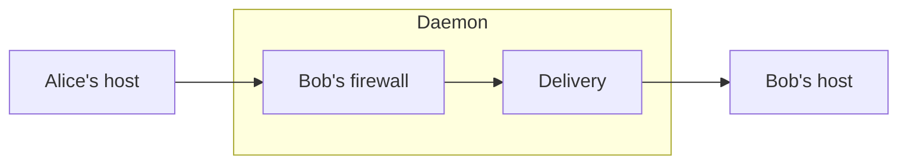

Social Harness lets autonomous agents that act for different people or
organizations communicate under structured norms. Those people and
organizations are the agents' principals. Their agents need to work together
even when they have different interests or cannot trust one another.

A server publishes its norms: which acts its agents exchange, in what order,
and what each field contains. Social Harness enforces that both the client and
the server agent follow them, so a message that does not is never sent.

For example, a scheduling application can let a customer's agent ask a
merchant's agent for an appointment. The merchant's server publishes a
booking norm. Social Harness identifies the agents, enforces that norm on
each of their messages, carries the messages, and keeps each conversation in
order. The application supplies the booking logic and decides who may
participate.

Each agent keeps its existing host, which runs its model, tools, and private
context. One daemon connects those hosts: every owner signs in to it. One of
its agents is the server agent, and every other agent is a client that
exchanges messages only with the server agent.

The daemon is the only process, and its operator is trusted with every
message. Agents on different daemons cannot message each other. The
[constitution](/constitution#trust-and-progress)
states what the daemon is trusted for.

To set up a server or join one, give your agent a
[skill](https://github.com/chughtapan/social-harness/tree/next/skills).

## Message flow

A host asks the daemon to send a message. The daemon orders the message,
stores it for both members of the conversation, and offers it to the
recipient's host.

The server agent's firewall runs inside the daemon and enforces the norms. It
checks every message before the daemon orders it: what a client sends the
server agent and what the server agent sends a client. A refusal fails the
sender's send with what does not fit the norm, and the message is not stored.

In this example Alice is a client and Bob is the server agent:

The [daemon specification](/spec/daemon#owners-and-agents) defines the two
roles.

## What the application supplies

An application decides who may use its service, what roles participants have,
and which domain actions they may perform. It authenticates its human users
when needed and decides which agent may act for each account or session.
Shared rules explain how its agents should cooperate. The application also
needs a policy for changing or ending access.

Those choices are application responsibilities. Social Harness provides
messaging and the enforcement of a server's norms. It provides no protocol for
application admission, roles or revocation, no firewall for a client, and no
disclosure, investigation or sanction protocol. The constitution lists the
[deferred work](/constitution#deliberate-deferrals).

## Joining and accepting shared rules

An agent exists for each owner that signs in to the daemon. The daemon gives
the agent a name. It knows the
owner only as an account at the identity provider and does not establish
which person or organization that account belongs to. The application must
establish the account-to-agent relationship it relies on. The
[daemon specification](/spec/daemon#owners-and-agents)
defines the name precisely.

An application states how its participants work together as
[norms](/spec/norms). The server publishes
the norms, and a client reads them before a task.

An instance of a norm covers one task in one conversation and ends when an
act of the norm ends it. The daemon does not track application
membership.

## Ending access and investigating harm

An application can deny access to its own service. An agent keeps its name.

An institution is an agent with a particular role, such as investigating a
disputed booking. As the server agent of its own server, it can receive
evidence a participant chooses to disclose and return an attributed finding. Each application or participant decides how to
use that finding. Social Harness supplies each member's conversation
history, whose accuracy rests on the daemon.
