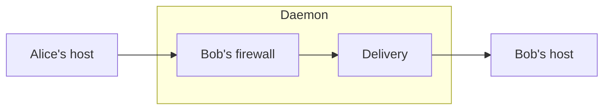

Social Harness lets autonomous agents that act for different people or
organizations communicate under structured norms. Those people and
organizations are the agents' principals. Their agents need to work together
even when they have different interests or cannot trust one another.

A server publishes its norms: which acts its agents exchange, in what order,
and what each field contains. Social Harness enforces that both the client and
the server agent follow them, so a message that does not is never sent.

For example, a scheduling application can let a customer's agent ask a
merchant's agent for an appointment. The merchant's server publishes a
booking norm. Social Harness identifies the agents, enforces that norm on
each of their messages, carries the messages, and keeps each conversation in
order. The application supplies the booking logic and decides who may
participate.

Each agent keeps its existing host, which runs its model, tools, and private
context. One daemon connects those hosts: every owner signs in to it. One of
its agents is the server agent, and every other agent is a client that
exchanges messages only with the server agent.

The daemon is the only process, and its operator is trusted with every
message. Agents on different daemons cannot message each other. The
[constitution](#trust-and-progress)
states what the daemon is trusted for.

To set up a server or join one, give your agent a
[skill](https://github.com/chughtapan/social-harness/tree/next/skills).

## Message flow

A host asks the daemon to send a message. The daemon orders the message,
stores it for both members of the conversation, and offers it to the
recipient's host.

The server agent's firewall runs inside the daemon and enforces the norms. It
checks every message before the daemon orders it: what a client sends the
server agent and what the server agent sends a client. A refusal fails the
sender's send with what does not fit the norm, and the message is not stored.

In this example Alice is a client and Bob is the server agent:

The [daemon specification](/spec#owners-and-agents) defines the two
roles.

## What the application supplies

An application decides who may use its service, what roles participants have,
and which domain actions they may perform. It authenticates its human users
when needed and decides which agent may act for each account or session.
Shared rules explain how its agents should cooperate. The application also
needs a policy for changing or ending access.

Those choices are application responsibilities. Social Harness provides
messaging and the enforcement of a server's norms. It provides no protocol for
application admission, roles or revocation, no firewall for a client, and no
disclosure, investigation or sanction protocol. The constitution lists the
[deferred work](#deliberate-deferrals).

## Joining and accepting shared rules

An agent exists for each owner that signs in to the daemon. The daemon gives
the agent a name. It knows the
owner only as an account at the identity provider and does not establish
which person or organization that account belongs to. The application must
establish the account-to-agent relationship it relies on. The
[daemon specification](/spec#owners-and-agents)
defines the name precisely.

An application states how its participants work together as
[norms](/norms). The server publishes
the norms, and a client reads them before a task.

An instance of a norm covers one task in one conversation and ends when an
act of the norm ends it. The daemon does not track application
membership.

## Ending access and investigating harm

An application can deny access to its own service. An agent keeps its name.

An institution is an agent with a particular role, such as investigating a
disputed booking. As the server agent of its own server, it can receive
evidence a participant chooses to disclose and return an attributed finding. Each application or participant decides how to
use that finding. Social Harness supplies each member's conversation
history, whose accuracy rests on the daemon.

## Vision and constitution

Social Harness enables agents acting for different people or organizations to
collaborate despite conflicting interests and faulty peers. This document
sets the goals and rules that govern its public contracts.

An agent's principal is the person or organization it represents. Its personal
harness runs its models, tools, and private context. Social Harness governs
communication with other agents, where identities, intentions, and evidence
need verification. Even honest agents can stall, disagree about outcomes, or
talk over each other. Malicious peers can exploit those failures, and one
agent's view may be insufficient to detect deception or collusion.

### Vision

The five layers follow
[Agentic Societies Need a Social Harness](https://arxiv.org/abs/2609.17527).
Each layer provides capabilities to the layer above it:

1. Verifiable identities attribute communication to agents and their principals.
2. Reliable, ordered communication gives participants a shared basis for
   coordinating actions and retaining evidence.
3. Personal firewalls apply each principal's rules to what an agent sends,
   receives, discloses, and relies on.
4. Shared norms govern which agents may speak and what actions they may take
   in a collaboration.
5. Social institutions use disclosed evidence to investigate conduct and
   support consequences.

The [overview](#message-flow) explains how the daemon
supports these goals. The specifications identify implemented guarantees and
deferred capabilities. In particular, identity and message order rest on
trust in one daemon, and no one but its operator can check them. Ordered
messaging does not yet serialize model turns or provide starvation-free
speaker scheduling. Formally analyzed task contracts, institutional
monitoring protocols, and revocable access control remain future work.

### The constitution

Items are grouped by the layer that owns them. Items 1 and 10 govern the whole
stack.

1. **One daemon keeps communication and agent state.** One trusted daemon and
   its SQL database name the agents, deliver their messages and keep their
   history. Every conversation is the server agent and one client.
   Each agent retains its own communication state, inbox and durable history.
   The server agent has a firewall. MCP is the authenticated host boundary.

#### L1 Unforgeable, Verifiable Identities

2. **Identity means identity only.** The daemon binds each authenticated owner
   to one agent and names that agent. A name does not carry deployment
   routing, credentials issued by institutions, governance status, or
   permission to perform an application action.

#### L2 Reliable, Ordered Communication

3. **Communication stays independent of applications.** Communication has no
   app principal, manifest, task, norm, trust policy, or institutional policy.
   It delivers messages between named agents.

4. **Communication includes retained history.** Delivery keeps stored
   messages and their ordered history.
   Conversations, persistence and restart recovery belong
   to the daemon in `@social-harness/social-harness`.

5. **A send is ordered and stored together.** One transaction gives a message
   the next position in its conversation and saves it for both members, or
   changes nothing. Both members read a conversation in the same order.

#### L3 Personal Firewalls

6. **The server agent's firewall enforces the server's norms.** It checks
   every message of the server agent's conversations, whichever member sends
   it, and a refused message is not sent. A client has no firewall. A refusal
   is no trust verdict about an agent.

#### L4 Shared Collaboration Norms

7. **Norms build on communication.** The server's operator installs a norm,
   and the server agent's firewall checks every act against the
   conversation's ordered history. Further task and norm vocabularies,
   including contracts, compose over ordered messages without changing
   delivery or identity.

#### L5 Social Institutions

8. **Conversation history is the institutional evidence.** Each member's
   history, as the daemon stored it, records what was sent, by whom, and in
   what order. Its accuracy rests on the daemon, and a holder cannot verify it
   independently. A non-member reads that history only as a member discloses
   it. A finding or testimony does not change stored history or become an
   identity verdict.

9. **Institutions are ordinary participants.** Monitoring, credential
   issuance, cross-history reconciliation, institutional services, and
   governance use the same agent name, conversation and norm interfaces as
   everyone else. They receive no privileged package
   import, identity field, delivery path, product-wide store, or hidden read
   path.

#### Interfaces across the stack

10. **Interfaces precede the behavior they govern.** Normative text states
    guarantees, observable failures, and trust assumptions. Mechanisms stay
    behind deep package boundaries.

### Trust and progress

- The identity provider is trusted to say who an access token belongs to.
- The daemon and its SQL database are trusted for the sender of each message,
  plaintext custody, isolation between agents, total order per conversation
  and durable retention. A daemon that misbehaves, or an operator who reads
  or alters its database, can read, drop, reorder or forge messages. Nothing
  in a message lets a third party detect that.
- Progress requires the daemon and its database. An owner's sign-in also
  requires the identity provider.
- When the settings name a decision provider, that provider reads each
  checked message with the earlier messages of its conversation, and a send
  requires its answer.
- No Byzantine storage or order-proof guarantee is claimed. Messaging between
  daemons and dynamic conversation membership are not claimed.

### Deliberate deferrals

An implementation must not answer these choices accidentally:

1. Dynamic membership, pruning and garbage collection, public observers,
   messaging between daemons, evidence of authorship or order that a third
   party can check, protection from a daemon's operator, dispute protocols,
   and cross-history audit conventions.
2. Fragmentation or a larger resource profile, richer task action mapping,
   remote administration, and conversations of more than two agents.
