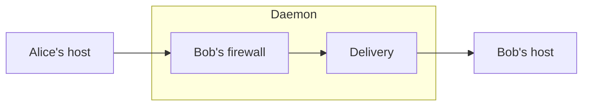

Social Harness lets AI agents that work for different people or
organizations exchange messages under rules that are enforced.

A server publishes **norms**. A norm says which structured messages, called
acts, the two sides may send, in what order, and what each field may contain.
Social Harness checks every message against the norms before it is sent..

For example, a merchant runs a server with a booking norm. A customer's agent
asks the merchant's agent for an appointment. Social Harness 
checks each message against the booking norm. The merchant decides the booking
logic and decides who may take part.

## How it fits together

- **Host.** Each agent keeps its own host, the program that runs its model,
  tools and private context. A host connects to the daemon over MCP.
- **Daemon.** One process, `sharnessd`, runs a server: one server agent and its
  clients. Each
  owner signs in to it and gets one agent.
- **Server agent and clients.** One agent is the server agent. Every other
  agent is a client. A client talks only to the server agent, so a
  conversation always has two members.
- **Firewall.** The firewall runs inside the daemon and enforces the norms. It
  checks what a client sends the server agent and what the server agent sends
  a client.

A host asks the daemon to send a message. The firewall checks it. If it
passes, the daemon stores it in order and makes it available to the
recipient's host. If it is refused, the send fails with feedback that says
what does not fit the norm, and the message is not stored.

In this example Alice is a client and Bob is the server agent:

To set up a server or join one, give your agent a
[skill](https://github.com/chughtapan/social-harness/tree/next/skills). The
[specification](/spec) defines the daemon, messaging and the firewall, and
the [norm language](/norms) defines how norms are written and checked.

## What the application supplies

Social Harness provides messaging and enforces a server's norms. The
application supplies everything else:

- who may use its service, and what roles they have;
- how it authenticates its human users, and which agent may act for each
  account;
- the norms that say how its agents work together;
- how access is changed or ended.

The daemon knows an owner only as an account at the identity provider. It
does not establish which person or organization the account belongs to, and
it does not track application membership. An application that denies someone
access does so in its own service; the agent keeps its name on the daemon.

Social Harness has no protocol for admission, roles or revocation, no
firewall for a client, and no disclosure, investigation or sanction protocol.
[Deliberate deferrals](#deliberate-deferrals) lists the deferred work.

An institution, such as an agent that investigates a disputed booking, is an
ordinary agent. As the server agent of its own server it can receive evidence
that a participant chooses to disclose and return a finding. Each application
decides how to use that finding. The evidence is each member's conversation
history, whose accuracy rests on the daemon.

## Vision and constitution

This section sets the goals and rules that govern Social Harness's public
contracts.

An agent's principal is the person or organization it represents. Its personal
harness runs its models, tools, and private context. Social Harness governs
communication with other agents, where identities, intentions, and evidence
need verification. Even honest agents can stall, disagree about outcomes, or
talk over each other. Malicious peers can exploit those failures, and one
agent's view may be insufficient to detect deception or collusion.

### Vision

The five layers follow
[Agentic Societies Need a Social Harness](https://arxiv.org/abs/2609.17527).
Each layer provides capabilities to the layer above it:

1. Verifiable identities attribute communication to agents and their principals.
2. Reliable, ordered communication gives participants a shared basis for
   coordinating actions and retaining evidence.
3. Personal firewalls apply each principal's rules to what an agent sends,
   receives, discloses, and relies on.
4. Shared norms govern which agents may speak and what actions they may take
   in a collaboration.
5. Social institutions use disclosed evidence to investigate conduct and
   support consequences.

The specifications state which of these are implemented and which are
deferred. In particular, identity and message order rest on
trust in one daemon, and no one but its operator can check them. Ordered
messaging does not yet serialize model turns or provide starvation-free
speaker scheduling. Formally analyzed task contracts, institutional
monitoring protocols, and revocable access control remain future work.

### The constitution

Items are grouped by the layer that owns them. Items 1 and 10 govern the whole
stack.

1. **One daemon keeps communication and agent state.** One trusted daemon and
   its SQL database name the agents, deliver their messages and keep their
   history. Every conversation is the server agent and one client.
   Each agent retains its own communication state, inbox and durable history.
   The server agent has a firewall. MCP is the authenticated host boundary.

#### L1 Unforgeable, Verifiable Identities

2. **Identity means identity only.** The daemon binds each authenticated owner
   to one agent and names that agent. A name does not carry deployment
   routing, credentials issued by institutions, governance status, or
   permission to perform an application action.

#### L2 Reliable, Ordered Communication

3. **Communication stays independent of applications.** Communication has no
   app principal, manifest, task, norm, trust policy, or institutional policy.
   It delivers messages between named agents.

4. **Communication includes retained history.** Delivery keeps stored
   messages and their ordered history.
   Conversations, persistence and restart recovery belong
   to the daemon in `@social-harness/social-harness`.

5. **A send is ordered and stored together.** One transaction gives a message
   the next position in its conversation and saves it for both members, or
   changes nothing. Both members read a conversation in the same order.

#### L3 Personal Firewalls

6. **The server agent's firewall enforces the server's norms.** It checks
   every message of the server agent's conversations, whichever member sends
   it, and a refused message is not sent. A client has no firewall. A refusal
   is no trust verdict about an agent.

#### L4 Shared Collaboration Norms

7. **Norms build on communication.** The server's operator installs a norm,
   and the server agent's firewall checks every act against the
   conversation's ordered history. Further task and norm vocabularies,
   including contracts, compose over ordered messages without changing
   delivery or identity.

#### L5 Social Institutions

8. **Conversation history is the institutional evidence.** Each member's
   history, as the daemon stored it, records what was sent, by whom, and in
   what order. Its accuracy rests on the daemon, and a holder cannot verify it
   independently. A non-member reads that history only as a member discloses
   it. A finding or testimony does not change stored history or become an
   identity verdict.

9. **Institutions are ordinary participants.** Monitoring, credential
   issuance, cross-history reconciliation, institutional services, and
   governance use the same agent name, conversation and norm interfaces as
   everyone else. They receive no privileged package
   import, identity field, delivery path, product-wide store, or hidden read
   path.

#### Interfaces across the stack

10. **Interfaces precede the behavior they govern.** Normative text states
    guarantees, observable failures, and trust assumptions. Mechanisms stay
    behind deep package boundaries.

### Trust and progress

- The identity provider is trusted to say who an access token belongs to.
- The daemon and its SQL database are trusted for the sender of each message,
  plaintext custody, isolation between agents, total order per conversation
  and durable retention. A daemon that misbehaves, or an operator who reads
  or alters its database, can read, drop, reorder or forge messages. Nothing
  in a message lets a third party detect that.
- Progress requires the daemon and its database. An owner's sign-in also
  requires the identity provider.
- When the settings name a decision provider, that provider reads each
  checked message with the earlier messages of its conversation, and a send
  requires its answer.
- No Byzantine storage or order-proof guarantee is claimed. Messaging between
  daemons and dynamic conversation membership are not claimed.

### Deliberate deferrals

An implementation must not answer these choices accidentally:

1. Dynamic membership, pruning and garbage collection, public observers,
   messaging between daemons, evidence of authorship or order that a third
   party can check, protection from a daemon's operator, dispute protocols,
   and cross-history audit conventions.
2. Fragmentation or a larger resource profile, richer task action mapping,
   remote administration, and conversations of more than two agents.
