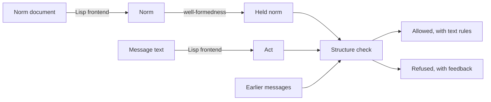

A norm says which acts the client and the server agent may send each other,
in what order, and what each field of an act holds. A server publishes its
norms: every member reads the documents with `read_norms`, and the daemon
holds both the client and the server agent to them. A message that does not
follow them is not sent.

This page defines the language in four parts: how a norm document and an act
are written, the norm a document denotes, when that norm is well formed, and
how the [firewall](../firewall.md#one-check)'s structure check judges a
message against it.



The frontend is the only part that knows Lisp. The well-formedness rules and
the structure check read a norm and an act as data.

## Example

A client books a meeting with the server:

```lisp
; A client books a meeting with the server.
(norm booking
  :description "The client asks for a meeting, the server offers slots, and the client picks one.")

(content request :by client :starts true :initiates requested
  (field topic :type string :min-length 1 :max-length 200
    :description "The subject of the meeting."))

(content offer :by server :when requested
  :terminates requested :initiates offered
  (field slots :type list :min-items 1 :max-items 3
    :description "One meeting slot: a date, start and end times, and a timezone."))

(content pick :by client :when offered :ends true
  (field slot :type string)
  (relation member slot (previous offer slots)))

(content decline :by (client server) :ends true)
```

Under this norm a conversation goes as follows. Each act after the first
names the message it replies to as `replyToMsgId` in the send input.

| # | Sender | Message | Replies to | Result |
| --- | --- | --- | --- | --- |
| 1 | client | `Hello, can we meet?` | | Refused: the message is not one act. |
| 2 | server | `(request :ontology booking :topic "Thesis outline")` | | Refused: `request` is not the server's to send. |
| 3 | client | `(request :ontology booking :topic "Thesis outline")` | | Allowed. It opens an instance, and `requested` holds. |
| 4 | server | `(offer :ontology booking :slots ("Mon 10:00-10:30 UTC" "Tue 14:00-14:30 UTC"))` | 3 | Allowed. `offered` holds in place of `requested`. |
| 5 | client | `(pick :ontology booking :slot "Wed 09:00-09:30 UTC")` | 4 | Refused: the slot is not one of the offered slots. |
| 6 | client | `(pick :ontology booking :slot "Tue 14:00-14:30 UTC")` | 3 | Refused: the reply chain from message 3 does not hold the offer. |
| 7 | client | `(pick :ontology booking :slot "Tue 14:00-14:30 UTC")` | 4 | Allowed. It ends the instance. |

Refused messages are not stored, so message 7 is the third message of the
conversation.

## Notions

| Notion | Meaning |
| --- | --- |
| Norm | A named set of forms. |
| Performative | The name of a kind of act, such as `offer`. |
| Form | What a norm declares for one performative: the fields an act of it carries, and its turn rule. |
| Field | A named value of an act: a string, an integer or a list of strings. |
| Act | What one message states: a performative, the norm it belongs to and a value for each field it carries. |
| Role | Which member of the conversation sends an act: `client`, or `server` for the server agent. A document does not declare roles. |
| Fact | A name that holds or does not hold during an instance. Acts set and clear facts, and forms wait on them. |
| Instance | One run of a norm in a conversation, from an act that starts it to an act that ends it. A conversation has at most one instance in progress. |

## Lexical structure

A norm document and a message's text are both sequences of these tokens:

| Token | Form |
| --- | --- |
| Whitespace | Any run of whitespace. It separates tokens and means nothing else. |
| Comment | `;` to the end of its line. A document may carry comments. A message that carries one is not an act. |
| `(` and `)` | Open and close a list. |
| String | A JSON string literal: text in double quotes with JSON escapes, on one line. It must decode to well-formed Unicode. |
| Symbol | Any other run of characters that holds no whitespace, parenthesis, `;` or `"`. |

Symbols divide by their form:

| Symbol | Form |
| --- | --- |
| Name | A lowercase letter followed by lowercase letters, digits or hyphens, 64 characters at most. Norms, performatives, fields and facts have names. |
| Keyword | `:` followed by the name of an attribute or a field, such as `:max-items`. |
| Number | A JSON number, such as `3`, `-2` or `1.5e3`. |
| Truth value | `true` or `false`. |

Nothing in a document or a message is evaluated.

## Norm documents

A document is one `norm` declaration followed by a `content` declaration for
each form. In this grammar, quoted words are symbols, `name`, `string` and
`number` are the tokens above, `[ x ]` is optional and `{ x }` repeats zero
or more times.

```ebnf
document   = norm , { content } ;

norm       = "(" , "norm" , name , [ ":description" , string ] , ")" ;

content    = "(" , "content" , name , { turn | field | relation } , ")" ;

turn       = ":by" , sender
           | ":starts" , truth
           | ":ends" , truth
           | ":when" , facts
           | ":terminates" , facts
           | ":initiates" , facts
           | ":max" , number
           | ":after" , name
           | ":delay" , name
           | ":unit" , "seconds" ;

sender     = role
           | "(" , role , { role } , ")"
           | "(" , "recipient" , "(" , "fact" , name , ")" , ")" ;
role       = "client" | "server" ;
facts      = name | "(" , { name } , ")" ;
truth      = "true" | "false" ;

field      = "(" , "field" , name , { field-attr } , ")" ;
field-attr = ":type" , type
           | ":optional" , truth
           | ":description" , string
           | bound , number ;
type       = "string" | "integer" | "list" ;
bound      = ":min-length" | ":max-length"
           | ":minimum" | ":maximum"
           | ":min-items" | ":max-items" ;

relation   = "(" , "relation" , operator , name , source , ")" ;
operator   = "equals" | "member" | "subset" ;
source     = "(" , "previous" , ( name | "(" , "fact" , name , ")" ) , name , ")" ;
```

The grammar leaves these rules to prose:

- The name of a declaration follows its first word. After it, attributes
  come in any order, and in a `content` declaration they may stand between
  fields and relations.
- A declaration takes each attribute at most once, and an attribute it does
  not take is an error. A misspelled attribute therefore fails the document.
- `:by` and `:type` are required. `:after`, `:delay` and `:unit` come
  together or not at all.
- A field takes only the bounds of its type: `:min-length` and `:max-length`
  for a string, `:minimum` and `:maximum` for an integer, `:min-items` and
  `:max-items` for a list.

## Acts

A message's text is an act when the whole text is one list: a performative
followed by keyword and value pairs.

```ebnf
act       = "(" , name , { keyword , value } , ")" ;
value     = string | symbol | "(" , { string | symbol } , ")" ;
```

```lisp
(offer :ontology booking :slots ("Mon 10:00-10:30 UTC" "Tue 14:00-14:30 UTC"))
```

- Each keyword is `:` and a name, and appears at most once.
- `:ontology` is required and names the act's norm. Every other pair is a
  field of the act.
- A string is text. A symbol in the form of a number is that number, and any
  other symbol is its own text. A list holds the text of each of its items,
  so a number inside a list is text.
- Text outside the list, a second list, a comment, a Markdown fence or an
  unclosed parenthesis makes the message no act.

The message a continuation replies to is not part of the act. The sender
supplies it as `replyToMsgId` in the
[send input](../host/messaging.md#sending-a-message), and none is inferred.

## The norm a document denotes

The frontend translates a document into a norm, which is plain data. The
well-formedness rules and the structure check are defined on this data and
not on the document's text.

```text
Norm     = { name, description, forms: Form* }

Form     = { performative,
             by: Sender,
             fields: Field*,
             starts, ends: Boolean,
             when, terminates, initiates: Fact*,
             max?: Number,
             delay?: { fact, field },
             relations: Relation* }

Sender   = roles(Role+)            ; a member that has one of these roles
         | recipient(Fact)         ; the recipient of the message that set the fact

Field    = { name, optional: Boolean, description?: String }
           and one of
             string  { minLength?, maxLength? }
             integer { minimum?, maximum? }
             list    { minItems?, maxItems? }

Relation = { operator: equals | member | subset,
             field,
             source: { act: ActRef, field } }

ActRef   = act(performative)       ; the latest act of this performative
         | fact(Fact)              ; the act that set this fact

Act      = { performative, norm, fields: name -> Value }
Value    = String | Number | String*
```

Each part of a document maps to one part of the norm:

| Document | Norm | When absent |
| --- | --- | --- |
| `(norm name …)` | `name` | Required. |
| `:description` of the norm | `description` | Empty. |
| `(content name …)` | A form whose `performative` is the name | |
| `:by` | `by` | Required. |
| `:starts`, `:ends` | `starts`, `ends` | False. |
| `:when`, `:terminates`, `:initiates` | `when`, `terminates`, `initiates` | No facts. |
| `:max` | `max` | No limit. |
| `:after f :delay d :unit seconds` | `delay` with `fact` f and `field` d | No delay. |
| `(field name …)` | A field | |
| `:optional` | `optional` | False: the field is required. |
| `:description` of a field | `description` | None. |
| `(relation op field (previous a f))` | A relation | |

The example's `pick` form is this value, shown as JSON:

```json
{
  "performative": "pick",
  "by": { "kind": "roles", "roles": ["client"] },
  "fields": [{ "name": "slot", "optional": false, "type": "string" }],
  "starts": false,
  "ends": true,
  "when": ["offered"],
  "terminates": [],
  "initiates": [],
  "relations": [
    {
      "operator": "member",
      "field": "slot",
      "source": { "act": { "kind": "act", "performative": "offer" }, "field": "slots" }
    }
  ]
}
```

A norm also keeps the document it came from and that document's SHA-256
digest, which names the exact text both members read.

## Well-formed norms

A document compiles only when the norm it denotes is well formed. The daemon
refuses to start with a document that does not compile.

1. The name of the norm, of every performative, of every field and of every
   fact is a name. No field is named `ontology`.
2. No two forms declare the same performative, and no two fields of a form
   have the same name.
3. At least one form starts an instance.
4. A field's lower bound is not above its upper bound. The bounds of a string
   and of a list are nonnegative integers.
5. `max` is a positive integer.
6. Every fact in a `when`, a `terminates`, a `recipient` sender, a delay or
   a fact reference is in the `initiates` of some form.
7. A form that starts an instance names its senders by role, has no `when`,
   no delay and no relation.
8. For a delay, every form that initiates the delay's fact declares the
   delay's field as a required integer whose `minimum` is zero or more.
9. For a relation, the form declares the relation's field, and every form
   the source may name declares the source's field. An act reference names
   one form, and a fact reference names every form that initiates the fact.
   The types fit the operator:

   | Operator | The form's field | The source's field |
   | --- | --- | --- |
   | `equals` | Any type | The same type |
   | `member` | String | List |
   | `subset` | List | List |

A norms directory must also give each norm a different name.

## Judging a message

The structure check judges one message at a time. Its inputs are the held
norms, the message with its sender's role and optional `replyToMsgId`, the
time of the check, and the conversation's stored messages, each with the
time of its own check. Its result allows the act and names its
[text rules](#text-rules), or refuses the message with
[feedback](#refusals). A server that holds no norm allows every message.

### State of a conversation

Judging uses this state, which the check rebuilds from the stored messages
each time and never saves:

| Part | Meaning |
| --- | --- |
| Known messages | The id of every stored message. |
| Instance | The instance in progress, if any: its norm and the parts below. |
| Facts | The facts that hold, each with the act that set it. |
| Counts | How many acts of each performative the instance allowed. |
| Acts | The acts the instance allowed, in order. |
| Members | The messages that belong to the instance, each with the message it replies to. |

The reply chain of a message id is that message, the message it replies to,
and so on, for as long as each is a member.

### Steps

A message is judged by these steps in order. The first step that fails
refuses the message at the stage shown.

| Step | The message is refused when | Stage |
| --- | --- | --- |
| 1 | Its text is not an [act](#acts). | Structural |
| 2 | No instance is in progress and `:ontology` names no held norm. | Structural |
| 3 | An instance is in progress and `:ontology` names another norm than the instance's. | Protocol |
| 4 | The norm declares no form for the performative. | Structural |
| 5 | A required field is missing, a stated field is not declared, or a value is not of its field's type or within its bounds. The feedback names every such field. | Structural |
| 6 | The form does not start an instance and the message has no `replyToMsgId`. | Protocol |
| 7 | The message has a `replyToMsgId` that is not a known message. | Protocol |
| 8 | No instance is in progress and the form does not start one, or an instance is in progress and the form starts one. | Protocol |
| 9 | An instance is in progress and the reply chain of `replyToMsgId` is empty: the act replies outside the instance. | Protocol |
| 10 | The sender is a `recipient` sender and its fact does not hold, or the act that set it is not in the reply chain. | Protocol |
| 11 | The sender is not one `by` permits: it lacks every listed role, or it is not the recipient of the message that set the fact. | Protocol |
| 12 | A fact of `when` does not hold, or the instance already allowed `max` acts of this performative. | Protocol |
| 13 | The form has a delay and the time of the check is earlier than the time the act that set the delay's fact was checked, plus as many seconds as that act's delay field says. | Protocol |
| 14 | A relation does not hold. | Protocol |

From step 2 on, the norm is the instance's norm when an instance is in
progress, and the norm `:ontology` names otherwise. An opening act is judged
by steps 1 to 8 and then step 11.

A field's value fits its type as follows:

| Type | Value | Bounds |
| --- | --- | --- |
| `string` | Text. | `minLength` and `maxLength` count code points. |
| `integer` | A whole number. | `minimum` and `maximum` are inclusive. |
| `list` | A list of texts, none empty. | `minItems` and `maxItems` count items. |

A relation holds a stated field to a value of an earlier act. The earlier
act is found in the reply chain: for an act reference, the latest allowed act
of that performative in the chain, and for a fact reference, the act that set
the fact, when the chain holds it.

| Operator | Holds when |
| --- | --- |
| `equals` | The field has exactly the earlier value. |
| `member` | The field is one of the earlier list's items. |
| `subset` | Every item of the field is one of the earlier list's items. |

A relation fails when the earlier act is not in the chain, when the act does
not state the relation's field, or when the operator does not hold. Setting a
fact again replaces the act a fact reference finds, so an old offer cannot
authorize a selection after a new one.

Two cases settle nothing and refuse the message as unresolved evidence, not
as a violation: a delay whose fact does not hold, and a relation whose
earlier act left out the source's optional field.

### Effects of an allowed act

A stored act changes the state as follows:

1. If its form ends an instance, the instance is over: no facts, counts, acts
   or members remain.
2. Otherwise, if no instance is in progress, one opens under the act's norm.
3. The facts of `terminates` stop holding. Then the facts of `initiates`
   hold, each set by this act.
4. The count of the act's performative rises by one, and the act joins the
   instance's acts.

A stored message becomes a member of the instance in progress when it is the
act that opened it, or when it replies to a member.

### Replay

The state before a message is the result of replaying the conversation's
stored messages in order. Each stored message is judged again by the steps
above, as its sender, at the time of its original check. A message that
passes has its effects. A message that does not pass has none, though it may
still become a member. That is a message stored before the norm documents
changed, or one stored while the server held no norms, which has no check
time.

A refused message is not stored, so it leaves no trace in the state and a
later message cannot reply to it. Nothing rewinds, reopens or cancels an
instance except an act of the norm.

## Text rules

The description of a string or list field is its text rule. When an allowed
act states a described field, the decision provider judges whether the field
holds what its description says and nothing else. A list's description says
what each of its items holds.

| Field | Rule text |
| --- | --- |
| String | `<field> must hold what its description says and nothing else: <description>` |
| List | `each item of <field> must hold what its description says and nothing else: <description>` |

A rule's id is `<norm>.<performative>.<field>`, such as
`booking.request.topic`. A document declares no other rule and no feedback:
the sender of an act that breaks a description reads the rule's text.

Write a description as what the field holds, such as "One meeting slot: a
date, start and end times, and a timezone." Anything else in the field breaks
the rule, so a description need not list unrelated instructions or prompt
injection. A field without a description is not judged. An integer is held
by its bounds alone, and its description only explains it.

The provider judges the act using which member sent it, the preceding
bounded conversation, the form's fields, the facts that hold and the norm's
description. The
[provider answers contract](../firewall.md#provider-answers) owns uncertainty
and provider failures.

## Refusals

A refused message's send fails with feedback that says what does not fit:
the form, the sender or the transition. Feedback about a transition names the
performative of the message the act replies to, when that message is an
allowed act.

| Refused at | Rule id | Feedback, for example |
| --- | --- | --- |
| Structural stage | `<norm>-structural` | `note is not a valid field of pick in booking.` |
| Protocol stage | `<norm>-protocol` | `pick is not valid after offer for booking.` |
| A text rule | `<norm>.<performative>.<field>` | The rule's text. |

In a structure check's rule id, the norm is that of the instance in
progress, and the word `norm` when there is none: `norm-structural`.

The server agent's failure also holds diagnostics: the norm, its digest, the
performative and the field when they are known, and the stage, which is
`structural` or `protocol` when the structure check refused and `semantic`
when the act fits and its text rules refused it or could not be judged. A
client reads the feedback alone, as
[refused messages](../firewall.md#refused-messages) states. A refusal does
not select a replacement act or reference, or instruct the agent to restart
an instance.

## Publishing norms

The daemon's `normsDirectory` setting names a directory. The daemon compiles
every `.lisp` file directly inside it before it serves, and holds the norms
they denote. `read_norms` returns each norm's name, description and
document. No rule file or built-in agreement is installed beside them, and a
message cannot install a norm.

Documents are read at startup. After a restart every conversation is judged
under the documents then in the directory, as [replay](#replay) describes.

A norm adds no delivery acknowledgment, notification, timer, send lock or
host behavior. A delay only refuses an act sent too early: it schedules
nothing, and the host waits.
